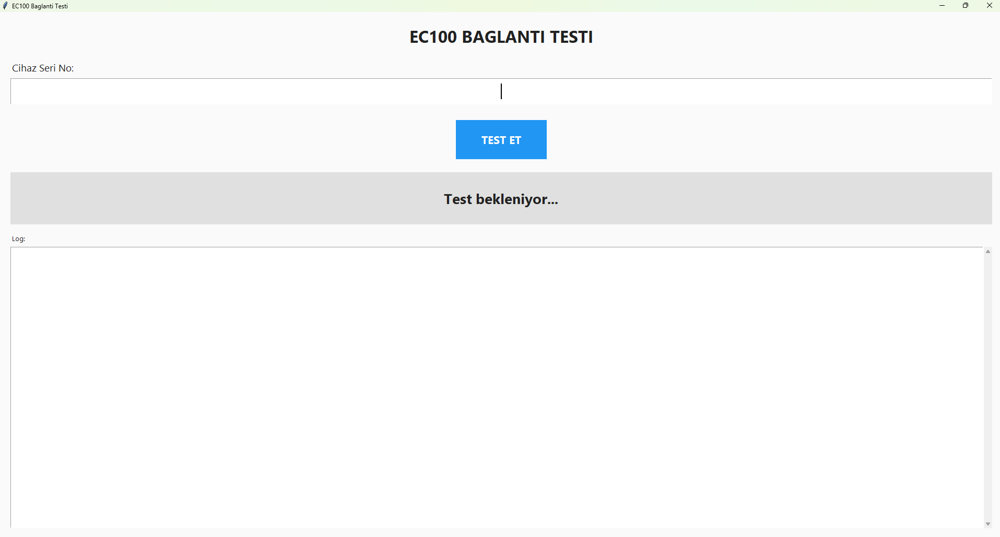
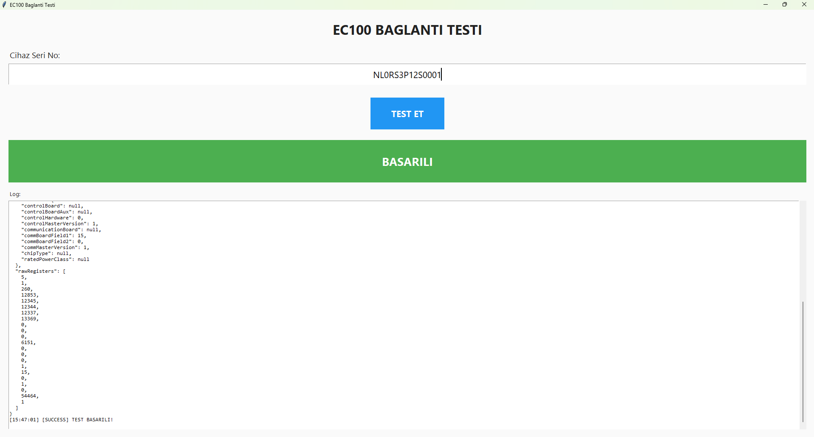

# EC100 Baglanti Test Uygulamasi

Uretim hattinda EC100 cihazlarinin inverter baglantisini dogrulamak icin kullanilan masaustu uygulamasi.

## Ne Ise Yarar?

Bu uygulama, EC100 gateway cihazinin inverter ile duzgun iletisim kurdugunu test eder. Uretim surecinde, cihaz teslim edilmeden once baglantilarin dogru yapiIdigini kontrol etmek icin kullanilir.

**Calisma Prensibi:**
1. Cihaz seri numarasi girilir
2. ThingsBoard uzerinden `getInverterInfo` RPC cagrisi yapilir
3. Inverter'dan veri okunabiliyorsa **BASARILI** (yesil)
4. Okuma basarisizsa **BASARISIZ** (kirmizi)

## Kurulum

Sadece ilk seferde gerekli:

1. `install.bat` dosyasina cift tiklayin
2. Kurulumun tamamlanmasini bekleyin

## Kullanim

1. `run.bat` dosyasina cift tiklayin
2. Cihaz seri numarasini girin (ornek: `NL0RS3P12S0001`)
3. **TEST ET** butonuna tiklayin
4. Sonucu bekleyin

## Ekran Goruntuleri

### Test Oncesi (Baglanti Bekleniyor)


### Test Sonrasi (Basarili)


## Teknik Detaylar

| Ozellik | Deger |
|---------|-------|
| Platform | Windows |
| Dil | Python 3 |
| UI | Tkinter |
| API | ThingsBoard REST API |
| RPC Metodu | `getInverterInfo` |
| Basari Kriteri | `kind == "InverterInfoState"` |

## Dosya Yapisi

```
ec100-connection-tester/
├── main.py           # Ana uygulama
├── api_client.py     # ThingsBoard API istemcisi
├── config.json       # Baglanti ayarlari
├── requirements.txt  # Python bagimliliklari
├── run.bat           # Uygulamayi baslat
├── install.bat       # Bagimliliklari kur
├── README.md         # Bu dosya
└── photos/           # Ekran goruntuleri
```

## Sorun Giderme

| Hata | Cozum |
|------|-------|
| "Cihaz bulunamadi" | Seri numarasini kontrol edin |
| "ThingsBoard baglanti hatasi" | Internet baglantisini kontrol edin |
| "Cihaz yanit vermedi" | Cihazin acik ve bagli oldugunu kontrol edin |
| "Gecersiz cevap" | Inverter baglantisini kontrol edin |
