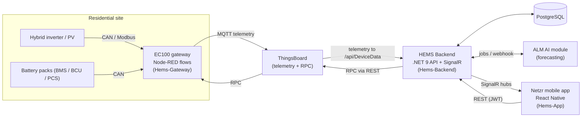

# Home Energy Management System (HEMS)

HEMS is a residential energy management platform for homes with solar PV, hybrid inverters
and battery storage. EC100 edge gateways read inverter, BMS and PCS data over CAN and Modbus
using Node-RED flows. They publish telemetry to ThingsBoard and take device commands back as
ThingsBoard RPC. A .NET 9 backend stores the data in PostgreSQL. It also manages sites, setups,
devices, users and device sharing, sends parameter changes to devices through ThingsBoard RPC,
raises alarms and notifications, and streams power flow to clients over SignalR. The mobile
app, a React Native app named **Netzr**, shows dashboards, energy flow, battery and inverter
details and history. Users can also change inverter modes and grid, battery and generator
settings from the app, and see AI-based consumption forecasts from the ALM module.

This monorepo combines three projects that were developed in separate repositories.

## Architecture



- **Upstream path (telemetry):** inverter/BMS → Node-RED on EC100 → ThingsBoard → backend → PostgreSQL. Live values reach the app over SignalR.
- **Downstream path (settings):** app → backend → ThingsBoard RPC → Node-RED RPC flow → device. The backend uses a write-verify-retry pattern and reports progress over SignalR.

## Projects

### Hems-App: mobile app (Netzr)

**Purpose:** a mobile app for homeowners, installers and administrators to monitor and control their sites.

**Stack:** React Native 0.81, React 19, TypeScript, Zustand, React Navigation 7, NativeWind
(Tailwind), react-hook-form with Zod, i18next, `@microsoft/signalr`, axios, and gifted-charts,
victory-native and d3-sankey for charts. Jest is used for tests.

**Key features**
- Authentication, sign-up, password reset, onboarding and site/setup creation
- A dashboard with hero summary, battery state, energy flow (Sankey) and energy source mix
- Detail screens for power metrics, SoC history, grid performance and energy revenue
- Device list and device details, including inverter and battery component details with multi-BMS battery packs
- Inverter mode selection and custom modes with time slots
- Device settings for grid, grid standard, battery, generator and smart load, plus export strategy
- Real-time updates over SignalR for power flow, device status, notifications and settings-update progress
- Notifications and alarms, device sharing and invitations through deep links
- AI forecast screen (ALM), an admin page, offline and maintenance screens, and a forced-update check

**Run locally**

```sh
cd Hems-App
npm install                # also runs patch-package (and pod-install on macOS)
# create a .env file with API_URL, APP_NAME and ENVIRONMENT (see env.d.ts)
npm start                  # Metro bundler
npm run android            # in a second terminal
# iOS (macOS only)
bundle install && bundle exec pod install && npm run ios
npm test                   # Jest
```

### Hems-Backend: API and real-time services

**Purpose:** the central API for HEMS. It handles identity, sites and devices, ingests
telemetry, controls devices through ThingsBoard RPC, and sends notifications.

**Stack:** .NET 9 with Clean Architecture (Domain / Application / Infrastructure / Web), CQRS
with MediatR, Minimal APIs, EF Core 9 with PostgreSQL, ASP.NET Core Identity with JWT,
FluentValidation, AutoMapper, SignalR, Hangfire and NSwag (Swagger). Tests use NUnit, Moq and
FluentAssertions. The build uses Docker, Cake and Jenkins.

**Key features**
- REST endpoints for sites, setups, devices, device components, device data, device settings,
  parameter schemas, dashboard, notifications, invitations, users, role management, locations,
  mobile app versions and ALM
- SignalR hubs:
  - `DeviceNotificationHub` for alerts
  - `PowerFlowHub` for live power flow, with a shared stream manager
  - `DeviceStatusHub` for online/offline status
  - `DeviceSettingsHub` for parameter-update progress
- ThingsBoard RPC integration (`ThingsBoardConnectorService`, `DeviceRpcExecutorService`).
  Parameter-to-RPC mapping, batched updates and exponential-backoff retries are built in.
- Energy data collection jobs (Hangfire), heartbeat and device status tracking, alarm processing
- Grid outage detection, and device restart handling after grid standard changes
- Role-based authorization (user and device-only JWT), a demo user, an audit/context service,
  and branded invitation emails
- `Hems.DeviceSimulator` for generating test telemetry. `SignalRTester` for testing the hubs.

**Run locally**

```bash
cd Hems-Backend
dotnet restore
dotnet build -c Debug -p:SkipNSwag=True                  # faster dev build
dotnet ef database update --project src/Infrastructure --startup-project src/Web
dotnet run --project src/Web                             # API; Swagger UI at /api, Hangfire at /hangfire, health at /health
dotnet run --project Hems.DeviceSimulator                # optional, separate terminal
dotnet test                                              # unit tests
```

The API and simulator can also be run with Docker (`docker compose up --build`). First supply
the environment variables listed under [Configuration](#configuration).

### Hems-Gateway: EC100 gateway flows and tools

**Purpose:** the device side of HEMS. It contains the Node-RED flows that run on EC100 gateways
and the desktop tools for commissioning those gateways.

**Contents** (under `ems-communication-jsons/`)
- `single-phase/` and `three-phase/` hold the Node-RED flows for the inverters:
  - CAN data models and guides
  - telemetry flows (general, monitoring, maintenance, settings) that publish over MQTT
  - RPC flows (settings, maintenance, monitoring, manager) that apply commands sent from the backend
  - basic read flows and tests
- `pcs-container/` holds BCU/PCS data models (including DBC files), telemetry flows and guides
  for container-type battery systems
- `application/` holds Python desktop tools:
  - **nodered-flow-manager** lists, adds, batch-imports, removes and backs up Node-RED flows on
    EC100 devices through the ThingsBoard RPC API
  - **ec100-connection-tester** is a production-line check that the gateway can read from the
    inverter (it calls the `getInverterInfo` RPC)
  - **hems-service-tunelling** is a PyQt6 provisioning tool for reverse SSH tunnels, with a
    SQLite device inventory

**Run locally**

Import the Node-RED flows into an EC100 Node-RED instance, or push them with the Flow Manager.
Each Python tool runs the same way:

```bash
cd Hems-Gateway/ems-communication-jsons/application/<tool>
pip install -r requirements.txt
python main.py
```

On Windows you can use the `install.bat` and `run.bat` scripts instead.

## Development history

These milestones are summarized from the Claude Code session history for the app and backend
(December 2025 to February 2026). The gateway history comes from its git log.

| Period | Milestones |
|---|---|
| Dec 2025 (late) | Refactored the device notification system and alarm processing. Set up stage environment configuration. Wrote SignalR integration docs for the frontend. Added corporate email templates and invitation expiry. Fixed heartbeat handling, standardized datetimes, and added a device settings service. |
| Dec 2025 to early Jan 2026 | Built the demo user with energy balance data. Analyzed multiple ThingsBoard RPC connections. Set up Docker with demo data. Ran the mobile app against a local Docker API from the Android emulator. |
| Jan 2026 (mid) | Added energy data collection with source discrimination (`CreatedBy`). Removed duplicate alarm endpoints. Set up demo devices and battery parameters. Fixed device-settings update flows, including the export strategy 400 error, energy mode value auditing and SignalR race conditions. Moved settings to resilient updates (fire-and-forget with progress over SignalR) and added time-slot constraints. Added mobile app version control and a forced-update mechanism. |
| Jan 2026 (mid to late) | Ran a settings gap analysis against the database. Reorganized grid settings by access level. Handled device restarts after grid standard changes. Added the EnergySourceMix endpoint. Deduplicated generator and smart load configuration. Reviewed backend/frontend consistency of the settings system. Many Android build fixes (Gradle cache, AGP 8.11, emulator issues) and moves between dev and stage endpoints. |
| Jan 2026 (late) | Added smart invitation redirect (app vs web) and device sharing by code. Integrated battery RPC data into the dashboard. Built battery details following the inverter pattern, with multi-BMS battery packs. Added a deep-link invite system and fixed email branding. |
| End Jan to early Feb 2026 | Integrated ALM (AI Learning Module) through a webhook, with prediction endpoints, job management and SignalR feedback. Cleaned up notification types. Added a context manager audit service. Added grid outage detection with notifications (`GRD-ALM-W33/W34`). |
| Gateway (ongoing) | Added RPC and telemetry flows for battery, grid connection status and generator/smart load. Assigned RPC triggers automatically. Added PCS/BCU data models and telemetry flows. Fixed duplicate `socketcan-config` IDs on batch flow import. Added combined BCU/PCS flows. Added the EC100 provisioning and test tools. |

## Repository layout

```
home-energy-management-system/
├── Hems-App/                  # React Native mobile app (Netzr)
│   ├── src/                   # app screens, components, services (SignalR), stores (Zustand), api
│   ├── android/  ios/         # native projects
│   └── docs/                  # frontend notes (SignalR updates, legal texts, ...)
├── Hems-Backend/              # .NET 9 backend
│   ├── src/                   # Domain, Application, Infrastructure, Web
│   ├── Hems.DeviceSimulator/  # telemetry simulator
│   ├── SignalRTester/         # hub test client
│   ├── tests/                 # Application / Domain unit tests
│   ├── docs/                  # feature and API design docs (RPC, settings, ALM, outage detection, ...)
│   ├── scripts/  sql/  database/  infra/
│   └── Hems-Backend.sln
└── Hems-Gateway/
    └── ems-communication-jsons/
        ├── single-phase/      # Node-RED flows + data models
        ├── three-phase/       # Node-RED flows + data models
        ├── pcs-container/     # BCU/PCS models and flows
        └── application/       # Python tools (flow manager, connection tester, provisioning)
```

More documentation is in each project. Some of these documents are in Turkish:
- `Hems-Backend/CLAUDE.md`
- `Hems-Backend/SYSTEM_OVERVIEW.md`
- `Hems-Backend/APPLICATION_FEATURES_DOCUMENTATION.md`
- `Hems-Backend/docs/`
- `Hems-App/docs/`
- the README files of the gateway tools

## Configuration

> **Secrets were removed from the git history.** Values such as database connection strings,
> ThingsBoard credentials, JWT signing keys, SMTP passwords, weather API keys and AI module
> endpoints show up as `***REMOVED***` in `appsettings*.json`, `docker-compose.yml` and the
> tool configuration files. None of these values work. Supply your own values before running
> anything.

- **Backend:** use .NET user-secrets for local development, for example
  `dotnet user-secrets set "ConnectionStrings:Hems_BackendDb" "<your-connection-string>" --project src/Web`.
  In containers and CI, use environment variables with the `__` separator, for example
  `ConnectionStrings__Hems_BackendDb`, `ThingsBoard__BaseUrl`, `ThingsBoard__Username` and
  `ThingsBoard__Password`.
- **Mobile app:** set `API_URL`, `APP_NAME` and `ENVIRONMENT` in a local `.env` file.
  `react-native-dotenv` reads this file. Do not commit it.
- **Gateway tools:** enter the ThingsBoard URL and credentials in the tool UI or in a local
  `config.json` that is not committed.

Never commit real credentials, tokens, host addresses or connection strings to this public repository.
